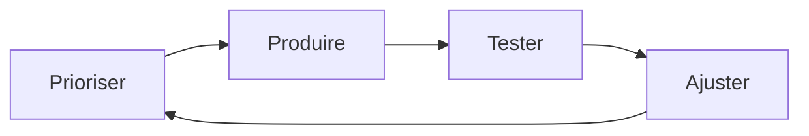
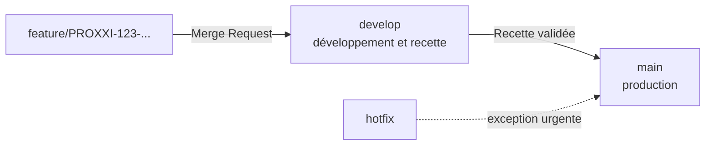

#  Organisation du projet

Ce document décrit **qui fait quoi**, **comment on travaille** et **avec quels outils**. Il s'adresse à toute personne qui rejoint l'équipe, y compris les nouveaux collaborateurs.

>  **Principe directeur :** on livre petit, souvent, et on s'améliore à chaque sprint.

---

## 1. L'équipe

| Rôle | Personne | Responsabilités |
|---|---|---|
| **Développeuse** | Amandine Delbouve (Kemp) | Conception, développement front et back, tests, documentation |
| **Administrateurs** (acteurs métier) | Sunita, Christophe, Cédric | Valident les besoins, participent à la recette fonctionnelle |

---

## 2. Méthode de travail : l'agile en sprints

Le projet avance par **sprints** : des cycles courts, avec un objectif clair.



Chaque sprint suit ces étapes :

1. **Prioriser** : choisir les tickets les plus utiles pour le métier ;
2. **Produire** : développer, en respectant la *Definition of Done* ;
3. **Tester** : tests automatiques, puis recette sur l'environnement de test ;
4. **Ajuster** : tirer les leçons, puis recommencer.

### Les cérémonies

| Cérémonie | Quand ? | Pourquoi ? |
|---|---|---|
| **Sprint Planning** | Au début du sprint | Choisir ce qui sera fait pendant le sprint |
| **Refinement / Backlog Grooming** | Régulièrement | Préparer et clarifier les tickets à venir |
| **Sprint Review** | À la fin du sprint | Montrer le travail réalisé aux parties prenantes |
| **Rétrospective** | À la fin du sprint | Identifier ce qui marche et ce qui doit changer |

---

## 3. Les outils

| Outil | Usage |
|---|---|
| **Jira** | Suivi des tickets, des critères d'acceptation et de l'avancement |
| **Confluence** | Documentation d'équipe, dont la page « Livret d'accueil » |
| **GitLab** | Code source, Merge Requests, pipeline CI/CD |
| **Figma** | Maquettes et wireframes de l'interface |
| **SonarQube / SonarLint** | Qualité du code |
| **ArgoCD** | Déploiement continu sur Kubernetes |

---

## 4. Le workflow Git

Le code suit un chemin strict, pour que la production reste toujours stable.



### Les règles à retenir

- **Toute évolution** passe par une **Merge Request (MR)** dont la cible est `develop`.
- **Pas de commit direct** sur `main` ni sur `develop`, sauf *hotfix* (correctif urgent en production).
- **La recette se fait sur `develop`**, avant toute fusion vers `main`.
- Chaque branche `feature/` est créée **depuis `develop`**.

### Le titre d'une MR

Le titre commence par la **référence Jira**. Exemple :

```
PROXXI-123-Add-authentication
```

### La description d'une MR

- un lien vers le ticket Jira ;
- les **captures d'écran avant / après** pour toute modification front-end.

---

## 5. Les définitions qui cadrent le travail

###  Definition of Ready (DoR) : « Je peux commencer »

Un ticket est prêt quand :

- [ ] le ticket Jira existe ;
- [ ] le besoin est compris ;
- [ ] les critères d'acceptation sont définis ;
- [ ] les informations nécessaires sont disponibles ;
- [ ] aucune question bloquante n'est en suspens.

###  Definition of Done (DoD) : « C'est terminé »

Un ticket est terminé quand :

- [ ] le développement est conforme aux critères d'acceptation ;
- [ ] le code respecte les standards (qualité, sécurité, SonarQube, accessibilité, éco-conception) ;
- [ ] la fonctionnalité est vérifiée **sur ordinateur et sur téléphone** ;
- [ ] les commits, la branche et la MR sont documentés et liés au ticket Jira ;
- [ ] tous les tests sont passés (automatiques et fonctionnels) ;
- [ ] la MR est revue et testée ;
- [ ] la fonctionnalité est déployée et validée en **recette** ;
- [ ] la documentation est mise à jour si nécessaire.

---

## 6. La recette fonctionnelle

À la fin de chaque sprint, les développements sont déployés sur le **serveur de recette**. On y vérifie :

- le comportement attendu ;
- les cas d'erreur principaux ;
- l'affichage front-end ;
- les parcours utilisateurs ;
- l'accessibilité ;
- l'absence de régression.

**La mise en production n'est possible que si** la fonctionnalité est validée en recette, qu'aucun bug n'est présent, que les anomalies sont corrigées et que le ticket Jira est à jour.

---

## 7. Onboarding :

Pour un nouveau collaborateur, le parcours d'intégration est le suivant :

1. **Présentation du projet** : contexte, objectifs et organisation (ce que vous lisez en partie ici) ;
2. **Découverte de Confluence** et de la documentation ;
3. **Lecture du « Livret d'accueil »** sur Confluence ;
4. **Premières tâches**, avec un accompagnement adapté ;
5. **Sessions de pair programming** pour monter en compétences et partager les connaissances.

---

> **Pour aller plus loin :** [Planning et roadmap](planning.md) · [Plan de tests](../05-tests/plan-tests.md) · [Déploiement](../06-deploiement/deploiement.md)
