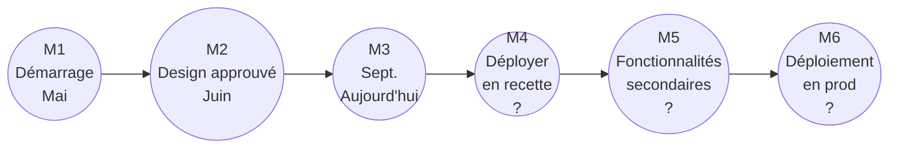

# Planning et roadmap

Ce document présente **où en est le projet** et **quelles sont les grandes étapes**.

> **Source :** la roadmap de l'équipe (sprint 0 jusqu'à la livraison). Les dates marquées *« ? »* n'ont pas encore été fixées.

---

## 1. Vue d'ensemble : six jalons

Le projet se découpe en **six jalons clés**, notés **M1 à M6**.



---

## 2. Les phases

Chaque phase a une couleur dans la roadmap. Voici leur contenu et leur statut.

| Phase | Jalon | Contenu | Statut |
|---|---|---|---|
| **Découverte** | M1 (mai) | Cadrage fonctionnel et technique | Terminée |
| **Conception** | M2 (juin) | Analyse MERISE complète (MCD, MLD, MPD), use cases, diagrammes de séquence | Terminée |
| **Figma** | Entre M2 et M3 | Maquettes validées | En cours de révision |
| **MVP fonctionnel** | M4 | Authentification et questionnaire |  À venir |
| **Croissance** | M5 | Fonctionnalités secondaires (statistiques, tableau de bord) |  À venir |
| **Déploiement en prod** | M6 | Mise en production |  À venir |

> ⚠️ **Point d'attention :** les maquettes Figma sont **en cours de révision** suite aux retours de la présentation. Tant qu'elles ne sont pas validées, le développement de l'interface doit rester prudent.

---

## 3. Où en sommes-nous ?

Le marqueur « Aujourd'hui » de la roadmap se situe au niveau du **jalon M3 (septembre)**.

```
M1 ──── M2 ──── M3 ──── M4 ⏳ ──── M5 ⏳ ──── M6 ⏳
mai        juin       sept.      ?          ?          ?
```

Cela signifie que :

- le **cadrage** et l'**analyse** sont derrière nous ;
- les **maquettes** sont presque prêtes ;
- la prochaine grande étape est le **MVP fonctionnel** (M4), avec la connexion Google et le questionnaire.

---

## 4. Le périmètre du MVP, dans l'ordre

Le MVP suit les priorités **MoSCoW** définies dans le [cahier des charges](../01-contexte/cachier-des-charges.md). Il est livré en priorité dans cet ordre logique :

| Ordre | Bloc fonctionnel | Pourquoi à ce moment-là ? |
|---|---|---|
| 1 | **Authentification Google** | Sans connexion sécurisée, rien d'autre ne peut être testé avec de vrais rôles |
| 2 | **Gestion des Proxxi et des collaborateurs** | Les données de base doivent exister avant tout le reste |
| 3 | **Attribution d'un collaborateur à un Proxxi** | Définit le périmètre de chaque Proxxi |
| 4 | **Gestion des rendez-vous** | Déclenche les rappels et les questionnaires |
| 5 | **Questionnaire de suivi** | Cœur de l'outil, qui alimente les alertes et les statistiques |
| 6 | **Alertes et rappels automatiques** | Dépendent des données créées aux étapes précédentes |

---

## 5. Les étapes suivantes

| Étape | Contenu | Date cible |
|---|---|---|
| Déployer en recette | MVP testé par les administrateurs | *À définir* |
| Fonctionnalités secondaires | Tableau de bord, statistiques, conservation des données | *À définir* |
| Déploiement en production | Mise en ligne pour les Proxxi et administrateurs | *À définir* |

---

> **Pour aller plus loin :** [Organisation du projet](organisation.md) · [Spécifications](../03-conception/specifications.md) · [Déploiement](../06-deploiement/deploiement.md)
