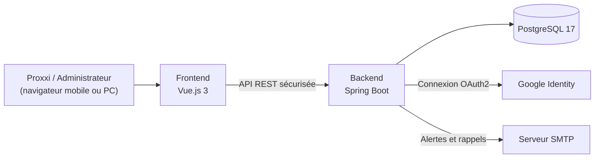
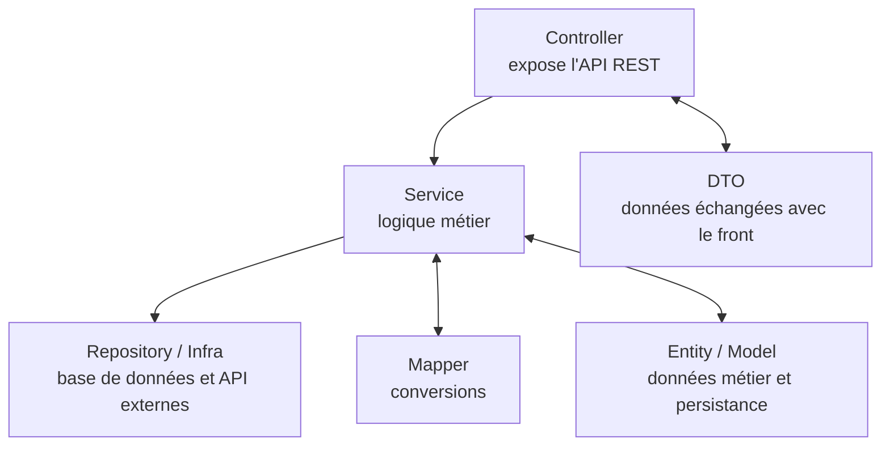
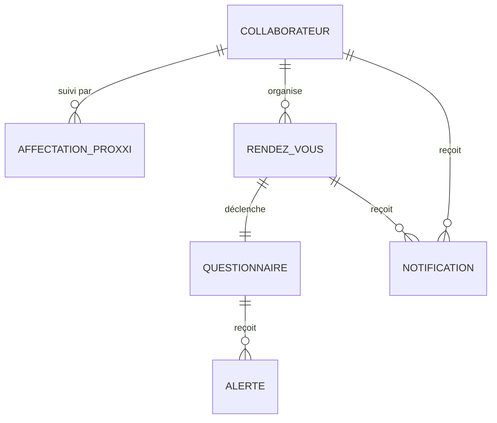

# Architecture technique

Ce document explique **comment l'application est construite**, en partant de la vue d'ensemble jusqu'aux détails de chaque couche.

> **Idée clé :** ProxxiConnect est une application **fullstack séparée**. Le front (ce que voit l'utilisateur) et le back (la logique et les données) sont deux projets distincts qui communiquent par une **API REST**.

> ⚠️ **État actuel :** le dépôt ne contient pas encore le code applicatif. Les arborescences présentées ci-dessous sont des **propositions** à valider au démarrage du développement.

---

## 1. Vue d'ensemble

| Brique | Rôle | Technologie |
|---|---|---|
| **Frontend** | Afficher les écrans et envoyer les actions de l'utilisateur | Vue.js 3, TypeScript, Vite, Tailwind CSS |
| **API REST** | Le « guichet » entre le front et le back | Échanges en JSON sur HTTP |
| **Backend** | Vérifier les droits, appliquer les règles métier, envoyer les notifications | Java 25, Spring Boot 3 |
| **Base de données** | Stocker les données de façon durable | PostgreSQL 17, migrations avec Liquibase |
| **Authentification** | Vérifier l'identité de l'utilisateur | Google OAuth2 |

---

## 2. Pourquoi séparer le front et le back ?

| Avantage | Explication simple |
|---|---|
| **Évolutivité** | On peut changer l'interface sans toucher aux règles métier |
| **Sécurité** | Toutes les vérifications de droits sont faites côté serveur, jamais seulement dans le navigateur |
| **Réutilisation** | La même API pourra servir un futur client (application mobile, export) |
| **Compétences** | Chaque partie peut être maintenue par une personne différente |

---

## 3. Le backend en couches

Le backend est découpé en **couches**. Chaque couche a une seule responsabilité.

| Couche | Ce qu'elle fait | Ce qu'elle ne doit **pas** faire |
|---|---|---|
| **Controller** | Reçoit une requête HTTP, appelle le service, renvoie une réponse | Contenir de la logique métier |
| **Service** | Applique les règles (un seul Proxxi par collaborateur, questionnaire verrouillé…) | Savoir comment le JSON est construit |
| **Repository / Infra** | Lit et écrit en base, appelle les API externes | Décider si une action est autorisée |
| **Mapper** | Convertit les entités en DTO et inversement | Faire des appels à la base |
| **DTO / Model / Entity** | Séparent les données échangées, métier et stockées | Être exposés tels quels au front |

> ⚠️ **Règle d'or :** les **entités JPA ne sont jamais exposées au frontend**. Elles sont des objets techniques liés à la base. On transmet uniquement des **DTO**, qui ne contiennent que ce dont le front a besoin.

---

## 4. Le frontend par écrans et blocs

| Élément | Rôle | Exemple dans ce projet |
|---|---|---|
| **Pages** | Les écrans principaux (`src/pages`) | `HomePage.vue`, `InternManagerPage.vue`, `UserManagerPage.vue` |
| **Layouts** | Le cadre commun autour des pages (`src/layouts`) | `Default.vue` |
| **Components** | Les blocs réutilisables (`src/components`, `src/components/common`) | `CommonButton.vue`, `InternsTable.vue`, `TemplateCard.vue` |
| **Stores Pinia** | L'état partagé entre les écrans (`src/stores`) | `userStore.js` (utilisateur connecté), `useNotificationStore.js` |
| **Services API** | Les appels au backend, un fichier par domaine (`src/services`), tous basés sur le client commun `useAuthFetch` (`src/middleware/useAuthFetch.js`) | `InternService.js`, `UserService.js` |
| **Router** | Les routes (`src/router/route.js`) et la garde d'authentification (`src/router/authRoute.js`) | Redirection vers la page de connexion si aucun jeton n'est présent |
| **Plugins / styles** | i18n et Vuetify (`src/plugins`), icônes MDI et Font Awesome | Thème et composants Vuetify 3 |

> **Bonne pratique :** si un composant dépasse une centaine de lignes ou fait plusieurs choses à la fois, c'est le signe qu'il faut le découper.

> **Règle à respecter :** un composant n'appelle jamais `fetch` directement. Il passe toujours par un service de `src/services`, qui lui-même passe par `useAuthFetch`. Ainsi, la gestion du jeton et des erreurs est écrite une seule fois.

---

## 5. Le modèle de données

Les données sont organisées autour de **six entités principales**. Le détail complet (dictionnaire, MCD, MLD, MPD) est disponible dans le dossier [MLD_MCD_MPD](../03-conception/MLD_MCD_MPD).

| Entité | Rôle | Exemples de champs |
|---|---|---|
| **Collaborateur** | La personne suivie | nom, prénom, email, client, mission actuelle, date d'arrivée, actif |
| **Affectation Proxxi** | Qui suit qui, et depuis quand | date de début, date de fin, changement en cours |
| **Rendez-vous** | Une rencontre planifiée ou réalisée | date du RDV, format, date de validation |
| **Questionnaire** | Le compte rendu d'un RDV | météo, ressenti, points d'amélioration, plan d'action, valide |
| **Alerte** | Un signal envoyé aux administrateurs | type, description, date, statut |
| **Notification** | Un message pour un utilisateur | type, message, date d'envoi, lu |

> **Historiser plutôt qu'écraser :** une affectation n'est jamais supprimée. Quand un collaborateur change de Proxxi, on **clôture** l'ancienne affectation (date de fin) et on en crée une nouvelle. C'est ce qui permet de garder l'historique.

---

## 6. Les choix technologiques et leur justification

Chaque technologie a été choisie pour une raison précise. Elle est listée ici pour qu'on puisse la retrouver facilement.

| Domaine | Choix | Pourquoi ce choix |
|---|---|---|
| Langage front | **TypeScript 5.x** | Déjà utilisé dans l'entreprise, typage pour réduire les erreurs |
| Framework front | **Vue.js 3.x** | Déjà présent dans l'écosystème, adapté aux interfaces modernes |
| Build | **Vite 6.x** | Démarrage et rechargement rapides en développement |
| CSS | **Tailwind CSS 4.x** | Interface responsive et cohérente, rapide à mettre en place |
| Composants UI | **Shadcn Vue** | Composants homogènes et accessibles |
| Langage back | **Java 25 LTS** | Cohérent avec les compétences internes |
| Framework back | **Spring Boot 3.x** | Framework maîtrisé pour des API robustes |
| Sécurité | **Spring Security 6.x** | Intégration naturelle avec Spring Boot |
| Authentification | **Google OAuth2** | Les collaborateurs utilisent déjà leur compte Google professionnel |
| Base de données | **PostgreSQL 17.x** | Robuste et déjà utilisée dans plusieurs projets |
| Migrations | **Liquibase** | Chaque changement de schéma est versionné et rejouable |
| Conteneurs | **Docker** | Environnements identiques en local et en production |

---

## 7. Vue de déploiement

L'application est déployée sur **Kubernetes** à partir de **Helm Charts**, et synchronisée par **ArgoCD**. Le processus complet est décrit dans le document [déploiement](../06-deploiement/deploiement.md).

---

## 8. Glossaire technique

| Terme | Définition simple |
|---|---|
| **API REST** | Une façon standard pour deux logiciels de se parler via HTTP, avec des adresses (`/api/collaborateurs`) et des verbes (`GET`, `POST`…) |
| **DTO** | *Data Transfer Object* : un objet qui ne contient que les données à transmettre |
| **Entité JPA** | Un objet Java lié à une table de la base de données |
| **Migration** | Un script qui modifie la structure de la base, versionné dans le temps |
| **Helm Chart** | Un modèle qui décrit comment installer une application sur Kubernetes |

---

> **Pour aller plus loin :** [Spécifications](specifications.md) · [Sécurité](../04-securite/securite.md) · [Déploiement](../06-deploiement/deploiement.md)
