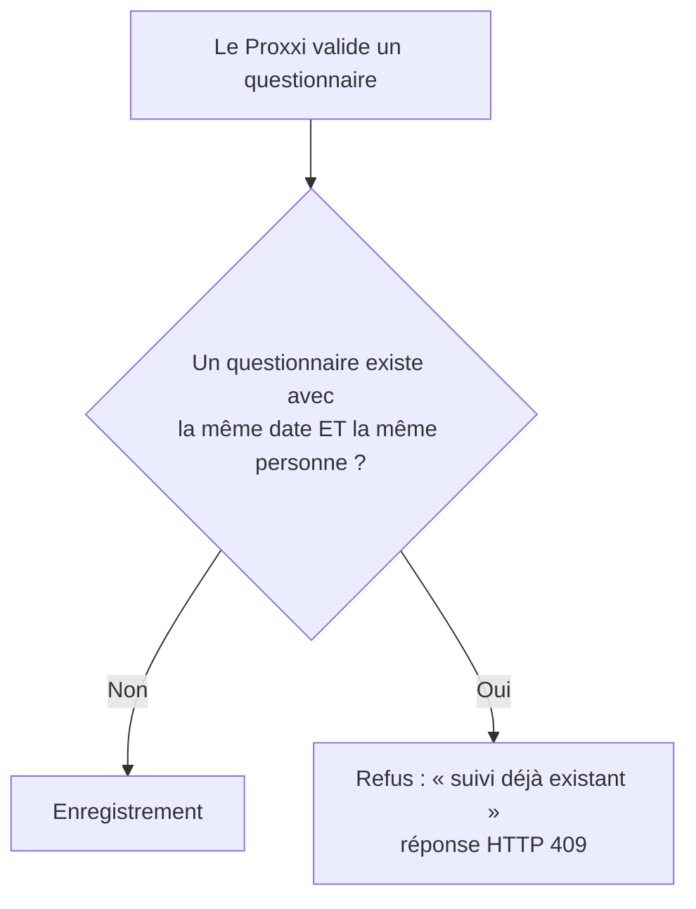
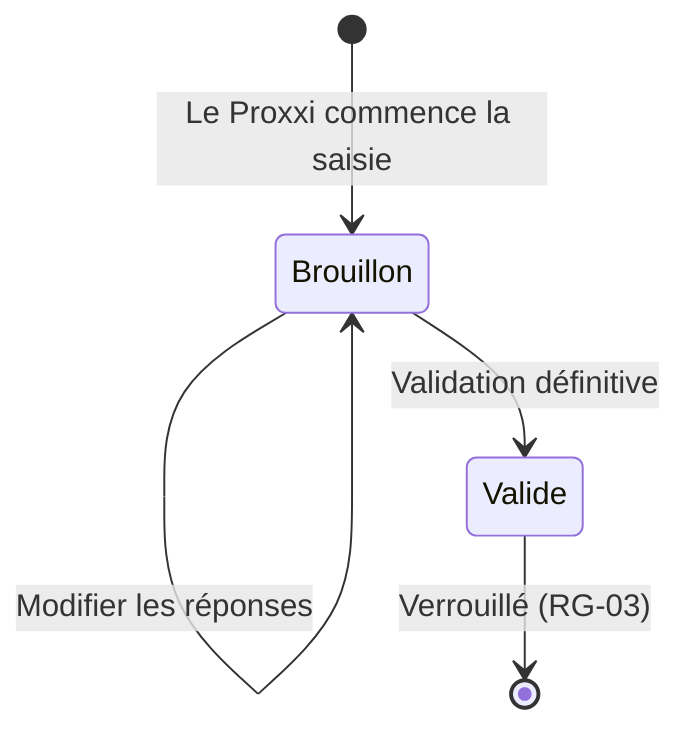

# Spécifications fonctionnelles

Ce document décrit **ce que fait** ProxxiConnect, fonctionnalité par fonctionnalité. Chaque exigence reçoit un **identifiant** (par exemple `F-05`) pour pouvoir être citée dans les tickets Jira, les tests et les merge requests.

> **Comment lire ce document ?** Pour chaque fonctionnalité, on trouve : son **acteur** (qui l'utilise), sa **priorité** (MoSCoW) et son **critère d'acceptation** (comment savoir qu'elle est bien faite).

---

## 1. Les fonctionnalités en un coup d'œil

| Fonctionnalité | Acteur | Priorité |
|---|---|---|
| Connexion via Google OAuth | Administrateur et Proxxi | Must |
| Gestion des Proxxi | Administrateur | Must |
| Gestion des collaborateurs | Administrateur | Must |
| Attribution d'un collaborateur à un Proxxi | Administrateur | Must |
| Gestion des rendez-vous | Proxxi | Must ⚠️ |
| Saisie du questionnaire de suivi | Proxxi | Must |
| Validation et verrouillage du questionnaire | Proxxi | Must |
| Alerte administrateur à chaque questionnaire soumis | Administrateur | Must |
| Alerte administrateur si un collaborateur n'a pas de Proxxi | Administrateur | Must |
| Email au collaborateur lors d'une nouvelle affectation | Collaborateur | Must |
| Rappels automatiques (RDV, questionnaires, relance 2 mois) | Proxxi | Must |
| Suivi des 3 rendez-vous obligatoires par exercice | Proxxi, Administrateur | Must |
| Tableau de bord et statistiques | Administrateur | Should |
| Conservation des données | Système | Should |
| Export PowerPoint `.pptx` | Administrateur | Could |

---

## 2. Détail des fonctionnalités MVP

### Connexion via Google OAuth

- **Acteurs :** Proxxi, Administrateur
- **Parcours :**
  1. L'utilisateur accède à l'application ;
  2. Il se connecte avec son compte Google ;
  3. Le système vérifie son **domaine** et son **rôle** ;
  4. Il accède à son espace.
- **Critère d'acceptation :**
  - *Quand* un utilisateur d'un domaine autorisé se connecte, *alors* il accède à l'espace correspondant à son rôle.
  - *Quand* un compte hors domaine autorisé tente de se connecter, *alors* l'accès est refusé.

### Gestion des Proxxi

- **Acteur :** Administrateur
- **Description :** créer, modifier et désactiver les profils Proxxi. Seuls les profils **actifs** peuvent recevoir une affectation.
- **Critère d'acceptation :** *quand* un Proxxi est désactivé, *alors* il n'apparaît plus dans la liste des affectations possibles, mais son historique est conservé.

### Gestion des collaborateurs

- **Acteur :** Administrateur
- **Description :** créer et modifier les fiches collaborateur (nom, prénom, email, client, mission actuelle, date d'arrivée, date de départ annoncée, statut actif).
- **Critère d'acceptation :** *quand* un collaborateur est créé, *alors* il apparaît dans la liste, sans Proxxi tant qu'aucune affectation n'a été faite.

### Attribution d'un collaborateur à un Proxxi

- **Acteur :** Administrateur
- **Description :** choisir un collaborateur, puis le Proxxi qui le suivra.
- **Critère d'acceptation :**
  - *Quand* on affecte un collaborateur à un nouveau Proxxi, *alors* l'ancienne affectation est clôturée (date de fin) et une nouvelle est créée.
  - *Quand* l'affectation est enregistrée, *alors* le collaborateur reçoit un email (F-10).

### Gestion des rendez-vous

- **Acteur :** Proxxi
- **Description :** planifier un rendez-vous avec un collaborateur : date (sélecteur de date), format (restaurant, site client ou visio).
- **Critère d'acceptation :**
  - *Quand* le Proxxi valide un RDV, *alors* il est enregistré et la notification « RDV à planifier » disparaît.

### Saisie du questionnaire de suivi

- **Acteur :** Proxxi
- **Description :** remplir le questionnaire fixe associé à un rendez-vous. Voir la [liste des champs](#4-le-questionnaire-de-suivi) ci-dessous.
- **Critère d'acceptation :** *quand* tous les champs obligatoires sont remplis, *alors* le Proxxi peut valider. Sinon, le formulaire ne part pas et les champs manquants sont signalés.

### Validation et verrouillage du questionnaire

- **Acteur :** Proxxi
- **Description :** la validation est **définitive**.
- **Critère d'acceptation :**
  - *Quand* le questionnaire est validé, *alors* la notification correspondante disparaît et une alerte est envoyée aux administrateurs (F-08) ;
  - *Quand* quelqu'un tente de modifier un questionnaire validé, *alors* la modification est refusée.

### Alerte administrateur à chaque questionnaire soumis

- **Acteur :** Administrateur
- **Critère d'acceptation :** *quand* un questionnaire est validé, *alors* un email est envoyé à **chaque** administrateur.

### Alerte si un collaborateur n'a pas de Proxxi

- **Acteur :** Administrateur
- **Critère d'acceptation :** *quand* un collaborateur actif n'a aucune affectation en cours, *alors* les administrateurs reçoivent une alerte par email.

### Email au collaborateur lors d'une nouvelle affectation

- **Acteur :** Collaborateur (reçoit un email, n'a pas de compte)
- **Critère d'acceptation :** *quand* un nouveau Proxxi est attribué, *alors* le collaborateur reçoit un email qui l'informe de son nouveau Proxxi.

### F-11 · Rappels automatiques

- **Acteur :** Proxxi
- **Les trois rappels :**

| Rappel | Déclencheur | Action proposée |
|---|---|---|
| **RDV à planifier** | Un collaborateur n'a pas de RDV planifié | Bouton « Planifier un RDV » |
| **Questionnaire à remplir** | Un RDV est réalisé sans questionnaire validé | Bouton « Questionnaire » |
| **Relance après 2 mois** | 2 mois se sont écoulés depuis la dernière rencontre | Alerte dans le tableau de bord |

### Suivi des 3 rendez-vous obligatoires

- **Acteurs :** Proxxi, Administrateur
- **Règle :** chaque collaborateur doit être vu **au minimum 3 fois** par exercice fiscal.
- **Critère d'acceptation :** *quand* le nombre de RDV réalisés est inférieur à 3 en fin d'exercice, *alors* le collaborateur est signalé comme « à risque » dans le tableau de bord.

---

## 3. Les règles de gestion

Les règles de gestion sont les lois du métier. Elles s'appliquent **quelle que soit** l'interface utilisée.

| ID | Règle | Exemple concret |
|---|---|---|
| **RG-01** | Un collaborateur appartient à **un seul Proxxi à la fois** | Si Julien passe de Laura à Sunita, Laura n'est plus son Proxxi |
| **RG-02** | Les questionnaires sont **fixes** | Pas de question ajoutée par un Proxxi à la volée |
| **RG-03** | Un questionnaire **validé ne peut plus être modifié** | Une erreur après validation se corrige par une nouvelle saisie, pas par une modification |
| **RG-04** | Les salariés **n'ont pas accès** à l'application | Ils reçoivent des emails, mais ne se connectent jamais |
| **RG-05** | Les données sont conservées **5 ans** | Au-delà, elles sont purgées automatiquement (voir F-14) |
| **RG-06** | Chaque collaborateur est vu **au moins 3 fois** par exercice fiscal | Trois RDV réalisés entre le 1er août et le 31 juillet |
| **RG-07** | L'exercice fiscal va du **1er août N-1 au 31 juillet N** | L'exercice « 2026-2027 » couvre du 1er août 2026 au 31 juillet 2027 |
| **RG-08** | Une relance est envoyée **2 mois après une rencontre** | RDV réalisé le 12 septembre → relance le 12 novembre |
| **RG-09** | Les administrateurs ont un **accès global** | Ils voient tous les collaborateurs et tous les questionnaires |
| **RG-10** | Les Proxxi ne voient que **leurs propres collaborateurs** | Laura ne voit pas les collaborateurs de Sunita |
| **RG-11** | Un **doublon** est un questionnaire de suivi ayant la **même date et la même personne** | Deux questionnaires pour Julien le 30/09 → le second est refusé |

### Focus : la règle des doublons (RG-11)

Pour éviter qu'un même échange soit enregistré deux fois, le système compare chaque nouveau questionnaire aux questionnaires existants :

---

## 4. Le questionnaire de suivi

Le questionnaire est **fixe** (RG-02). Il est composé de quatre blocs.

| Bloc | Champs | Obligatoire ? |
|---|---|---|
| **Identification** | Nom, prénom, client, mission actuelle, date et format du RDV (restaurant, site client, visio) | Oui, sauf « mission actuelle » |
| **Suivi** | Météo du suivi, changement de mission, ressenti Nextoo, points d'amélioration, formations suivies, aide BA, difficultés rencontrées, changement de vie personnelle | Oui |
| **Actions** | Plan d'action, commentaire du Proxxi | Oui *(à confirmer)* |
| **Validation** | Date de validation, indicateur « valide » | Automatique |

### La météo du suivi

La météo est une **réponse déclarative** : le collaborateur (via le Proxxi) choisit ce qui lui correspond. **Aucune règle automatique de gravité** n'est appliquée. C'est l'humain qui interprète.

| Météo | Signification | Icône |
|---|---|---|
| **Ensoleillé** | Tout va bien | |
| **Pluvieux** | Quelques difficultés | |
| **Tornade** | Situation sensible | |
| **Glacial** | Isolement ou blocage | |

### Cycle de vie d'un questionnaire

---

## 5. Les notifications et alertes

| Destinataire | Type | Déclencheur |
|---|---|---|
| **Proxxi** | Notification dans l'application | RDV à planifier, questionnaire à remplir, relance 2 mois |
| **Collaborateur** | Email | Nouveau Proxxi attribué |
| **Administrateur** | Email | Questionnaire soumis |
| **Administrateur** | Email | Collaborateur sans Proxxi |

---

## 6. Le reporting

Les administrateurs disposent d'indicateurs pour piloter le dispositif :

- nombre de réponses par **météo** ;
- nombre d'échanges **par Proxxi** ;
- **évolution** des suivis dans le temps ;
- répartition des **formats** de rendez-vous ;
- filtrage par **exercice fiscal**.

---

## 7. Exigences non fonctionnelles

| Domaine | Exigence | Détail |
|---|---|---|
| Ergonomie | Mobile-first | Conçu d'abord pour un téléphone, puis adapté à l'ordinateur |
| Accessibilité | RGAA | Voir le document [sécurité](../04-securite/securite.md) et le plan de tests |
| Performance | LCP, INP, CLS | Mesurés avec Lighthouse ; objectifs chiffrés *à définir* |
| Sécurité | Accès contrôlés | Voir le document [sécurité](../04-securite/securite.md) |
| Sobriété | Éco-conception | Voir le document [éco-conception](../07-ecoconception/ecoconception.md) |
| Légal | RGPD | Données personnelles protégées, conservation limitée |

---

## 8. Charte graphique

| Élément | Valeur |
|---|---|
| Bleu Galactique | `#1A2A4A` (textes, sous-titres, fonds secondaires) |
| Rouge T65 | `#C8102E` (titres, éléments importants) |
| Blanc Stormtrooper | `#F5F4F0` (fonds principaux) |
| Titres | Krona One |
| Texte et boutons | Montserrat (Regular pour le texte, Semi-Bold pour les boutons) |

---

## 9. Maquettes

Les écrans clés (connexion, tableau de bord, collaborateurs, rendez-vous, retour Proxxi, affectation, synthèse) sont présentés dans la section 22 du [cahier des charges](../01-contexte/cachier-des-charges.md#22-wireframes) et dans le dossier [maquettes](maquettes).

---

> **Pour aller plus loin :** [Expression du besoin](../01-contexte/expression-besoin.md) · [Architecture](architecture.md) · [Plan de tests](../05-tests/plan-tests.md)
