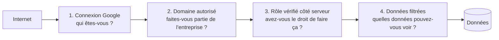
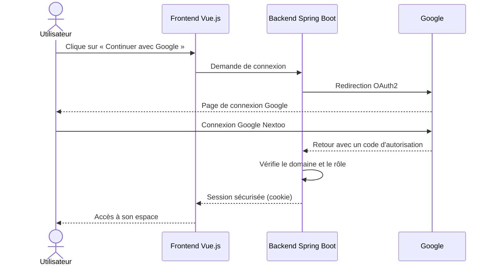

# Sécurité

ProxxiConnect manipule des **données personnelles** sur des salariés et des **situations sensibles** (démotivation, isolement, burn-out). La sécurité n'est donc pas une option : c'est une exigence du projet.

> **Principe central : la défense en profondeur.** On ne compte jamais sur une seule protection. Si une couche est contournée, la suivante doit encore bloquer l'attaque, comme dans un immeuble : code d'entrée, badge, puis fermeture à clé du bureau.

---

## 1. Vue d'ensemble des protections

| Couche | Question posée | Protection |
|---|---|---|
| 1 | Qui êtes-vous ? | Authentification via Google OAuth2 |
| 2 | Êtes-vous dans l'entreprise ? | Contrôle du domaine autorisé |
| 3 | Avez-vous le droit d'agir ? | Contrôle des rôles côté backend |
| 4 | Quelles données voyez-vous ? | Un Proxxi ne voit que ses collaborateurs |

---

## 2. Authentification : le fonctionnement

L'application ne gère **aucun mot de passe**. C'est Google qui vérifie l'identité, ce qui réduit le risque de fuite de mots de passe.

### Les codes de réponse à connaître

Quand quelque chose ne va pas, le serveur répond avec un **code HTTP**. Les équipes front et back doivent utiliser les mêmes.

| Code | Nom | Quand l'utiliser ? |
|---|---|---|
| **400** | Bad Request | Un champ obligatoire est manquant ou invalide |
| **401** | Unauthorized | L'utilisateur n'est pas connecté, ou ses identifiants sont invalides |
| **403** | Forbidden | L'utilisateur est connecté, mais n'a pas le droit d'accéder à cette ressource |
| **409** | Conflict | Doublon détecté (même date, même personne) |
| **500** | Internal Server Error | Erreur inattendue. **Le détail technique ne doit jamais être affiché à l'utilisateur** |

---

## 3. Qui peut faire quoi ?

Ce tableau est la **référence** pour les contrôles d'accès. Chaque règle doit être vérifiée **côté backend**.

| Action | Administrateur | Proxxi |
|---|---|---|
| Voir tous les collaborateurs | OUI | (seulement les siens) |
| Gérer les affectations Proxxi ↔ collaborateurs | OUI | |
| Gérer les Proxxi | OUI | |
| Planifier un rendez-vous |  | (ses collaborateurs) |
| Remplir un questionnaire |  | (ses collaborateurs) |
| Consulter les questionnaires | (tous) | (les siens) |
| Consulter les statistiques | OUI | |
| Exporter les reportings | OUI | NON |
| Recevoir les alertes | OUI | (notifications de ses collaborateurs) |

---

## 4. Les mesures de sécurité

### Côté authentification et session

| Mesure | Pourquoi ? |
|---|---|
| **Authentification Google OAuth2** | Pas de mot de passe à stocker ni à perdre |
| **Contrôle du domaine autorisé** | Seuls les comptes de l'entreprise peuvent entrer |
| **Cookies `HttpOnly`** | Le JavaScript du navigateur ne peut pas lire le cookie (protection contre le vol par script) |
| **Cookies `Secure`** | Le cookie n'est envoyé que via HTTPS |
| **Cookies `SameSite`** | Limite l'envoi du cookie depuis d'autres sites (protection contre certaines attaques) |

### Côté données et API

| Mesure | Pourquoi ? |
|---|---|
| **Contrôles d'accès côté backend** | Le serveur a le dernier mot |
| **Validation des entrées** (Jakarta Validation) | Rejeter les données malformées avant de les traiter |
| **CORS restreint** | Seules les origines autorisées peuvent appeler l'API |
| **Rate limit** | Limiter le nombre de requêtes pour freiner les abus |
| **Erreurs sans stack trace** | Un message technique révèle la structure interne à un attaquant |
| **DTO** | Ne jamais exposer les entités JPA, pour éviter de révéler des champs sensibles |

### Côté secrets et déploiement

| Mesure | Pourquoi ? |
|---|---|
| **Aucun secret dans le code** | Un dépôt Git peut être copié ou consulté par erreur |
| **Aucun secret dans les images Docker** | Une image peut être partagée ou archivée |
| **Secrets via variables d'environnement** | Ils sont injectés au moment de l'exécution, pas stockés dans le projet |
| **Trivy en pipeline** | Détecte les dépendances vulnérables et les secrets oubliés dans le code |

>  **Si vous avez commité un secret par erreur :** ne vous contentez pas de le supprimer dans le commit suivant. Il reste dans l'historique Git. Il faut **le révoquer et en générer un nouveau**, puis prévenir le responsable du projet.

---

## 5. Les variables d'environnement sensibles

| Variable | Rôle | Où la trouver ? |
|---|---|---|
| `SPRING_DATASOURCE_PASSWORD` | Mot de passe de la base | Gestionnaire de secrets, jamais dans le dépôt |
| `GOOGLE_CLIENT_SECRET` | Secret OAuth Google | Console Google Cloud |
| `GOOGLE_CLIENT_ID` | Identifiant client OAuth | Console Google Cloud |
| `ALLOWED_DOMAIN` | Domaine Google autorisé | Configuration du projet |
| `MAIL_HOST` / `MAIL_PORT` | Serveur SMTP | Infrastructure (à définir) |

---

## 6. Protection des données personnelles (RGPD)

| Principe RGPD | Application dans ProxxiConnect |
|---|---|
| **Minimisation** | Ne collecter que les champs utiles au suivi |
| **Limitation de la conservation** | Purge automatique après **5 ans** (job planifié) |
| **Confidentialité** | Un Proxxi ne voit que ses collaborateurs |
| **Intégrité** | Un questionnaire validé ne peut plus être modifié |
| **Traçabilité** | Historisation des affectations et des échanges |

> **Important :** la météo et les réponses du questionnaire peuvent révéler des informations sur la santé ou la vie personnelle. Leur accès doit être strictement limité.

---

## 7. Checklist de revue de code sécurité

Chaque merge request doit être relue avec cette grille. Elle couvre les six risques définis dans le cahier des charges.

- [ ] **Accès** : chaque nouvel endpoint vérifie l'authentification **et** le rôle côté backend
- [ ] **Accès** : un Proxxi ne peut pas accéder aux données d'un collaborateur qui ne lui est pas attribué
- [ ] **Secrets** : aucun mot de passe, token ou clé n'est présent dans le code ou dans les fichiers de configuration versionnés
- [ ] **Dépendances** : aucune nouvelle dépendance n'introduit de vulnérabilité critique (rapport Trivy)
- [ ] **Données** : aucune donnée personnelle n'apparaît dans les logs
- [ ] **API** : les entrées sont validées, et les réponses ne renvoient que les champs nécessaires (pas d'entité JPA)
- [ ] **Erreurs** : aucune stack trace n'est renvoyée à l'utilisateur

---

> **Pour aller plus loin :** [Architecture](../03-conception/architecture.md) · [Spécifications](../03-conception/specifications.md) · [Déploiement](../06-deploiement/deploiement.md)
