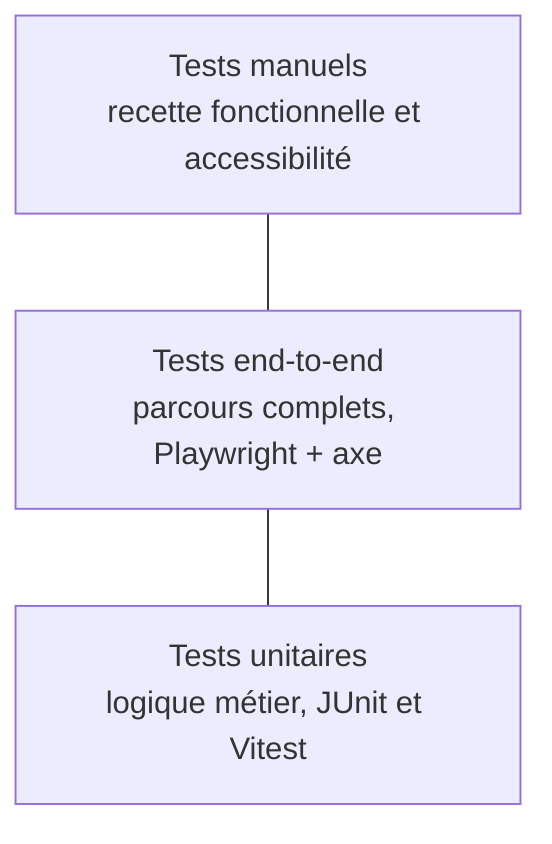

# Plan de tests

Tester, c'est **vérifier que l'application fait ce qu'elle doit faire**, et **détecter les problèmes avant les utilisateurs**. Ce document définit *quoi* tester, *comment* et *avec quels outils*.

> **Principe :** plus un test est bas dans la pyramide, plus il est rapide et nombreux. Plus il est haut, plus il est réaliste et lent.

---

## 1. La pyramide des tests

| Niveau | Ce qu'on teste | Qui ? | Quand ? |
|---|---|---|---|
| **Unitaire** | Une fonction ou une règle isolée (calcul, validation, règle de doublon) | Développeur | À chaque commit, en CI |
| **End-to-end** | Un parcours complet, du clic à la base de données | Automatique | À chaque merge request, en CI |
| **Fonctionnel manuel** | L'ensemble de l'application, comme un utilisateur | Recette | À la fin de chaque sprint |
| **Accessibilité manuelle** | La pertinence réelle de l'interface pour un utilisateur de lecteur d'écran, par exemple | Humain | Avant chaque recette |

---

## 2. Les tests unitaires

Ils ciblent **la logique métier et les règles de gestion** : services, calculs, validations.

- **Outils :** JUnit (backend), Vitest (frontend), Jacoco (couverture backend)
- **Objectif :** couverture minimale de **80 %**, vérifiée par SonarQube
- **Exemples à couvrir en priorité :**
  - la règle « un collaborateur n'a qu'un Proxxi à la fois » (RG-01) ;
  - le calcul de l'exercice fiscal (RG-07) : du 1er août au 31 juillet ;
  - la détection des doublons (RG-11) ;
  - le verrouillage d'un questionnaire validé (RG-03).

> **Exemple de cas de test :** *« Étant donné un questionnaire validé le 12/09/2026, quand on tente de le modifier, alors une exception est levée. »*

---

## 3. Les tests end-to-end

Ils simulent un **utilisateur réel** qui navigue dans l'application. Ils sont exécutés en CI.

- **Outil :** Playwright
- **Accessibilité automatisée :** axe-core, intégré aux tests Playwright, pour vérifier les règles WCAG et RGAA
- **Commande :** `pnpm test:e2e` (voir le [README](../../README.md))

---

## 4. Les scénarios de test prioritaires

Chaque scénario correspond à une fonctionnalité des [spécifications](../03-conception/specifications.md). Les identifiants `T-xx` seront repris dans les [résultats de tests](resultats-tests.md).

| ID | Scénario | Acteur | Résultat attendu | Réf. |
|---|---|---|---|---|
| **T-01** | Connexion avec un compte du domaine autorisé | Proxxi | Accès à son espace | F-01 |
| **T-02** | Connexion avec un compte hors domaine | Inconnu | Accès refusé | F-01 |
| **T-03** | Un Proxxi consulte sa liste de collaborateurs | Proxxi | Seuls ses collaborateurs sont affichés | RG-10 |
| **T-04** | Un Proxxi tente d'accéder à un collaborateur qui n'est pas le sien (via l'URL) | Proxxi | Refus (403) | RG-10 |
| **T-05** | Attribution d'un collaborateur à un Proxxi | Administrateur | Ancienne affectation clôturée, nouvelle créée, email envoyé | F-04, F-10 |
| **T-06** | Un collaborateur change de Proxxi | Administrateur | Un seul Proxxi actif à la fois | RG-01 |
| **T-07** | Saisie complète d'un questionnaire | Proxxi | Questionnaire enregistré | F-06 |
| **T-08** | Validation avec un champ obligatoire manquant | Proxxi | Refus (400), champ signalé, formulaire non envoyé | F-06 |
| **T-09** | Validation définitive d'un questionnaire | Proxxi | Questionnaire verrouillé, notification supprimée | F-07 |
| **T-10** | Modification d'un questionnaire validé | Proxxi | Refus | RG-03 |
| **T-11** | Validation d'un questionnaire | Proxxi | Email envoyé à chaque administrateur | F-08 |
| **T-12** | Questionnaire en doublon (même date, même personne) | Proxxi | Refus (409), message « suivi déjà existant » | RG-11 |
| **T-13** | Collaborateur sans Proxxi | Système | Alerte envoyée aux administrateurs | F-09 |
| **T-14** | Relance 2 mois après une rencontre | Système | Rappel affiché au Proxxi | RG-08 |
| **T-15** | Statistiques filtrées par exercice fiscal | Administrateur | Données du 1er août au 31 juillet uniquement | RG-07, F-13 |
| **T-16** | Parcours complet sur téléphone | Proxxi | Interface utilisable sans défilement horizontal | Mobile-first |
| **T-17** | Remplissage du questionnaire au clavier uniquement | Proxxi | Tous les champs sont atteignables et valables | RGAA |

---

## 5. Les tests manuels

### 5.1 Recette fonctionnelle (fin de sprint)

À la fin de chaque sprint, l'application est déployée sur le **serveur de recette**. Les administrateurs et la développeuse vérifient :

- [ ] le comportement attendu conforme aux critères d'acceptation ;
- [ ] les cas d'erreur principaux ;
- [ ] l'affichage front-end ;
- [ ] les parcours utilisateurs complets ;
- [ ] l'absence de régression sur les fonctionnalités précédentes.

### 5.2 Tests d'accessibilité manuels

Les outils automatiques ne détectent qu'une partie des problèmes. Le contrôle humain est indispensable.

| Outil | Ce qu'il permet de vérifier |
|---|---|
| **WAVE** | Erreurs visuelles et structurelles sur une page |
| **Accessibility Insights** | Parcours de test guidés, dont la navigation au clavier |
| **Lighthouse** | Audit rapide des bonnes pratiques |
| **ESLint a11y** | Erreurs d'accessibilité détectées dans le code, en local |

Points de contrôle :

- [ ] Navigation complète au **clavier** (Tab, Entrée, Échap)
- [ ] **Focus visible** sur chaque élément interactif
- [ ] **Labels explicites** sur chaque champ de formulaire
- [ ] **Titres** hiérarchisés (`h1`, puis `h2`, puis `h3`)
- [ ] **Contrastes** suffisants entre texte et fond
- [ ] Liens et boutons **compréhensibles hors contexte** (pas de « cliquez ici »)
- [ ] Alternatives textuelles pour les **images** et les **icônes de météo**

---

## 6. Tests de responsive design

Le projet est *mobile-first*. Chaque écran doit être vérifié sur plusieurs tailles.

| Support | Largeur indicative | À vérifier |
|---|---|---|
| Téléphone | 375 px | Lecture, saisie, boutons accessibles au pouce |
| Tablette | 768 px | Mise en page intermédiaire |
| Ordinateur | 1280 px et plus | Tableaux et tableau de bord lisibles |

> *Largeurs proposées à titre indicatif. Elles peuvent être ajustées selon les appareils réellement utilisés par les Proxxi.*

---

## 7. Les barrières de qualité en CI

La pipeline bloque automatiquement une merge request si un seuil n'est pas atteint.

| Contrôle | Seuil | Effet si échec |
|---|---|---|
| Tests unitaires | Tous passent | Pipeline en échec |
| Couverture de code | ≥ 80 % | Quality Gate en échec, MR bloquée |
| Analyse SonarQube | Quality Gate respectée | MR bloquée |
| Scan Trivy | Aucune faille critique | Déploiement impossible |
| Tests end-to-end et axe | Tous passent | Pipeline en échec |

---

## 8. Ce qui n'est pas encore testé

| Sujet | Statut |
|---|---|
| Tests de charge | Non prévus à ce stade. À envisager si le nombre d'utilisateurs augmente |
| Tests de performance (LCP, INP, CLS) | Lighthouse en CI. Seuils à fixer (voir [éco-conception](../07-ecoconception/ecoconception.md)) |
| Tests de purge RGPD | À prévoir avant la mise en production |

---

> **Pour aller plus loin :** [Résultats des tests](resultats-tests.md) · [Spécifications](../03-conception/specifications.md) · [Déploiement](../06-deploiement/deploiement.md)
