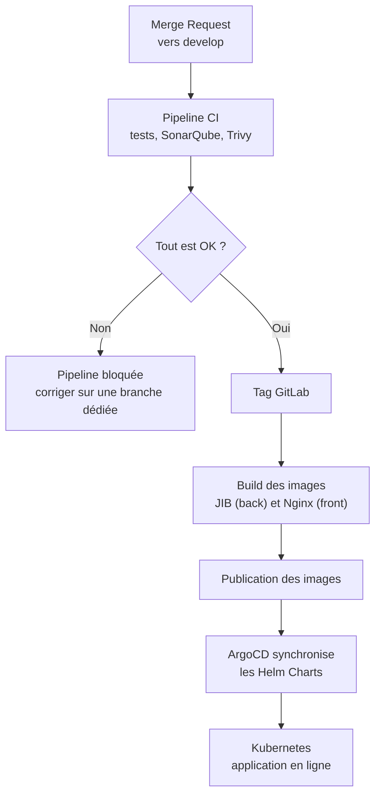

# Déploiement

Ce document explique **comment une modification passe du poste du développeur jusqu'à l'application en ligne**. Le processus est automatisé : c'est la pipeline qui fait le travail, pas une personne qui copie des fichiers à la main.

> **Idée clé :** on ne déploie jamais « à la main ». Chaque étape est vérifiée automatiquement, et une étape qui échoue **arrête tout**.

---

## 1. Vue d'ensemble



---

## 2. Les acteurs du déploiement

| Outil | Rôle | Analogie |
|---|---|---|
| **GitLab CI** | Lance les tests et la pipeline | Le contrôle qualité en usine |
| **SonarQube** | Analyse la qualité du code | Le contrôleur qui vérifie les finitions |
| **Trivy** | Cherche les failles et les secrets | Le détecteur de sécurité à l'entrée |
| **JIB** | Construit l'image Docker du backend, sans Dockerfile | Le moule qui fabrique le produit |
| **Nginx** | Sert les fichiers du frontend | Le serveur qui affiche la vitrine |
| **Helm Charts** | Décrivent comment installer l'application | La notice de montage |
| **ArgoCD** | Compare l'état souhaité et l'état réel, puis corrige | Le chef d'atelier qui s'assure que tout est conforme |
| **Kubernetes** | Fait tourner les conteneurs | L'usine qui exécute le travail |

> **ArgoCD en une phrase :** il récupère un tag, met à jour le fichier `values.yaml` avec les nouvelles images (back et front), puis applique le changement sur Kubernetes. On parle de **GitOps** : ce qui est dans Git est ce qui tourne en production.

---

## 3. Les environnements

| Environnement | Rôle | Qui l'utilise ? | Quand ? |
|---|---|---|---|
| **Local** | Développer sur son poste | Développeuse | En continu |
| **Recette** | Valider les fonctionnalités avant production | Administrateurs, développeuse | Fin de chaque sprint |
| **Production** | Application utilisée au quotidien | Proxxi, administrateurs | Après validation en recette |

### Lancer l'environnement local

```bash
# 1. Démarrer la base de données
docker compose up -d postgres

# 2. Lancer le backend
cd backend
./mvnw spring-boot:run

# 3. Lancer le frontend
cd frontend
pnpm install
pnpm dev
```

> Détails et prérequis : voir le [README](../../README.md).

---

## 4. Procédure de déploiement pas à pas

### Étape 1 · Préparer la modification

- [ ] Le ticket Jira respecte la *Definition of Ready* ;
- [ ] La branche `feature/` est créée depuis `develop` ;
- [ ] Les tests passent en local.

### Étape 2 · Ouvrir la Merge Request

- [ ] Le titre commence par la référence Jira (ex. `PROXXI-123-Add-authentication`) ;
- [ ] La cible est `develop` ;
- [ ] La description contient le lien Jira et les captures avant / après (si front).

### Étape 3 · Laisser la pipeline travailler

La pipeline exécute, dans l'ordre :

1. lint et vérification des types (ESLint, vue-tsc) et formatage (Prettier) ;
2. tests unitaires et couverture (JUnit, Vitest, Jacoco) ;
3. tests end-to-end et accessibilité (Playwright, axe-core) ;
4. analyse SonarQube et **Quality Gate** ;
5. scan Trivy des dépendances et des secrets.

> ⚠️ **Si une étape échoue,** la MR est bloquée. Ne contournez jamais la pipeline.

### Étape 4 · Créer le tag

Une fois les tests OK et Trivy sans faille critique, un **tag GitLab** est créé. C'est lui qui déclenche le déploiement.

### Étape 5 · Vérifier dans ArgoCD

- [ ] La synchronisation du backend est réussie ;
- [ ] La synchronisation du frontend est réussie ;
- [ ] Les pods sont en état « Running » ;
- [ ] Aucun événement d'erreur n'apparaît dans les logs.

### Étape 6 · Valider en recette

Les administrateurs et la développeuse vérifient les fonctionnalités livrées. Voir le [plan de tests](../05-tests/plan-tests.md).

---

## 5. Que faire en cas d'échec ?

| Symptôme | Ce qu'il faut faire |
|---|---|
| La pipeline échoue sur les tests | Corriger sur une **branche dédiée**, fusionner dans `develop`, puis créer un **nouveau tag** |
| Trivy signale une faille critique | Mettre à jour la dépendance concernée, puis relancer |
| Le Build semble bloqué | **Patience :** le Build réessaie automatiquement. L'erreur peut n'apparaître que quelques minutes plus tard |
| ArgoCD affiche « Degraded » | Consulter les événements et les logs du pod dans ArgoCD |
| La nouvelle version ne s'affiche pas | Vérifier que le **dernier tag** est bien celui attendu |

> ⚠️ **Ne relancez pas le déploiement à répétition** sans comprendre l'erreur. Chaque tentative inutile complique le diagnostic.

---

## 6. Les points d'attention

### Front et back ne sont pas liés

Le back et le front se synchronisent **indépendamment**, et le dernier tag est pris par défaut. Cela peut conduire à une version du front qui ne correspond pas à la version du back.

> **Bonne pratique :** avant chaque déploiement, vérifier que les tags front et back sont compatibles (même version fonctionnelle, mêmes contrats d'API).

### Les secrets ne sont jamais dans l'image

Les secrets sont injectés à l'exécution, via les variables d'environnement. Voir la liste dans le document [sécurité](../04-securite/securite.md#5-les-variables-denvironnement-sensibles).

### Le délai d'affichage des erreurs

Les tentatives automatiques du Build peuvent retarder l'affichage d'une erreur de quelques minutes. Un échec apparent n'est donc pas toujours immédiat.

---

## 7. Retour arrière (rollback)

| Question | Réponse |
|---|---|
| Comment revenir à la version précédente ? | *À définir* : ArgoCD permet de revenir à un historique de synchronisation, mais la procédure n'a pas encore été écrite et testée |
| Qui peut déclencher un retour arrière ? | *À définir* |
| Comment prévenir les utilisateurs ? | *À définir* |

---

## 8. Hébergement et infrastructure

| Élément | Choix |
|---|---|
| Hébergement | Cloud |
| Orchestration | Kubernetes |
| Gestion GitOps | ArgoCD + Helm Charts |
| Base de données | PostgreSQL 17 |

---

> **Pour aller plus loin :** [Architecture](../03-conception/architecture.md) · [Plan de tests](../05-tests/plan-tests.md) · [Sécurité](../04-securite/securite.md)
